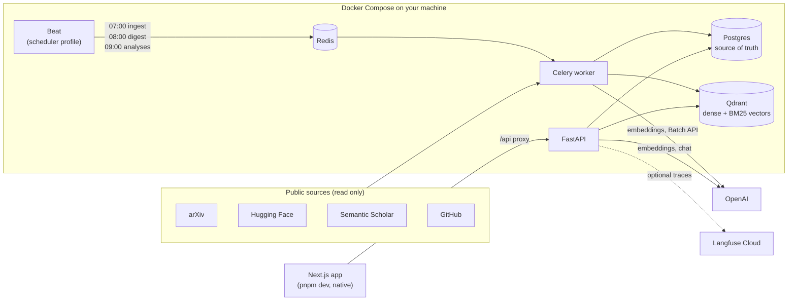

# AI Research Copilot

A personal, local-first research assistant for AI papers. Every morning it fetches new
arXiv papers, indexes their abstracts (and the full text of the papers you care about) for
hybrid search, and ranks them against your interests in a daily digest. You ask questions
and get answers whose every sentence cites a passage you can open. It also compares papers,
draws topic timelines, keeps a library with BibTeX export and drafts related-work sections.

<!-- Demo GIF: record a short screen capture of a chat answer with a citation chip opening
     its passage, save it as docs/demo.gif and replace the line below with
      -->
*Demo GIF: to be added (`docs/demo.gif`).*

Everything runs on your machine with Docker Compose. The only outside services are the
public APIs it reads (arXiv, Hugging Face, Semantic Scholar, GitHub) and OpenAI, for
embeddings and answers. A typical chat turn costs about $0.001.

## Architecture



- **Postgres** holds papers, text, chunks, the digest, the library, usage and evaluation
  runs. **Qdrant** is derived from it and can be rebuilt.
- A **question** goes through six stages, each its own function with its own switch
  (`condense`, `plan`, `search`, `rerank`, `generate`, `verify`; `docs/adr/0006`), so the
  evaluation can switch any of them off and measure what it adds.
- The **nightly pipeline** is a chain of idempotent Celery tasks (see "The daily pipeline").
- Design decisions are in `docs/adr/`.

## Stack
- Backend: Python 3.12, FastAPI, SQLAlchemy 2 + Alembic, Celery + Redis (Beat schedules)
- Search: Qdrant with two named vectors per chunk: `text-dense` (OpenAI
  `text-embedding-3-small`, 1536 dims, cosine, int8 quantization) and `text-sparse`
  (BM25 via FastEmbed, IDF applied by Qdrant), fused with Reciprocal Rank Fusion
  (`docs/adr/0014`); an optional cross-encoder reranker (`docs/adr/0015`)
- Models: OpenAI `gpt-4o-mini` for answers, the Batch API for paper analyses
  (`docs/adr/0016`), `text-embedding-3-small` for embeddings. Model names live in config.
- Frontend: Next.js (App Router), TypeScript, Tailwind, TanStack Query
- Evaluation: our own retrieval metrics and an LLM judge that follows the RAGAS metric
  definitions (see "Evaluation" for what that does and does not mean)
- Optional: Langfuse Cloud traces, one per chat turn with a span per stage

## Quick start
You need Docker Desktop (Compose v2), [uv](https://docs.astral.sh/uv/) 0.12 (it installs
Python 3.12 for you), Node 24 with pnpm (`corepack enable`) and an OpenAI API key. The
design target is an Apple Silicon Mac; the release workflow builds arm64 and amd64 images
(see "Releases").

1. `git clone` the repository and `cd` into it. Copy `.env.example` to `.env` and set
   `OPENAI_API_KEY`. In your OpenAI account, set a monthly spending limit: it is the hard
   backstop behind the app's own budget cap.
2. `make up` builds the backend image and starts Postgres, Qdrant, Redis, the API and the
   Celery worker, and waits until each one's healthcheck passes. The first build downloads
   the Python packages (a few hundred MB) and the three store images.
3. `make migrate` creates the database schema. It runs on the host through uv and installs
   the backend dependencies on its first run.
4. Ingest a paper to have something to ask about:
   `make ingest-one ID=1706.03762`. It downloads the paper's text from public sources and
   embeds it (a fraction of a cent).
5. Start the web app: `cd frontend && pnpm install && pnpm dev`, then open
   http://localhost:3000. Ask a question on `/chat`.

To get a digest and new papers every morning you also need the scheduler (next section).
To seed the corpus before that, `make backfill DAYS=7` indexes the last week of abstracts.

### What `make up` starts
| Service | Started by `make up` | Notes |
| --- | --- | --- |
| postgres, qdrant, redis | yes | ports bound to 127.0.0.1 only |
| api (FastAPI, port 8000) | yes | |
| worker (Celery, concurrency 1) | yes | runs ingestion and analysis tasks |
| beat (the scheduler) | **no** | `make up-scheduler` starts it |
| frontend | no | run it natively with `pnpm dev` (the compose `frontend` profile exists for a container) |

**Why Beat is separate.** Beat sends a daily run that came due while it was stopped as soon as
it starts. Starting it after a night off therefore fetches from arXiv and Hugging Face and
calls OpenAI right away. That happened twice during development, so a plain `make up` does
not start it. `make up-scheduler` does, and `make down` stops everything including Beat
(`docs/adr/0013`).

### The budget cap
`/settings` has a monthly budget cap in USD, compared with this month's spend from the usage
log (`llm_usage`, which every model call writes). When the spend reaches the cap, the
**background** jobs that spend money pause: abstract and full-text embedding, the embedding of
edited interests, and the Batch API submit and collect. Free steps keep running, and so do
chat, search and compare, which you start yourself. A banner on every page says when the cap
has paused the jobs; raising the cap or a new month resumes them. The check is made when a
job starts, so a run can overshoot by its own cost, and a Batch job's cost is counted when
its results are collected.

### The health page
`/health` shows whether Postgres, Qdrant and Redis answer, the last run of every pipeline step
(and why a step did nothing), how many papers are in each full-text state, how many tasks wait
in the queue, how many points the search index holds, and this month's spend against the cap.
It reads the API's `GET /status`, every 30 seconds. `GET /health` is the plain probe Docker's
healthcheck uses.

### Releases
Pushing a version tag such as `v1.0.0` builds the backend and the frontend images for
`linux/amd64` and `linux/arm64` and publishes them to the GitHub Container Registry as
`ghcr.io/<owner>/<repo>-backend` and `ghcr.io/<owner>/<repo>-frontend`
(`.github/workflows/release.yml`; only a commit on `main` is published). `docker-compose.yml`
builds from source; it does not pull these images.

## Commands
| Command | What it does |
| --- | --- |
| `make up` / `make down` / `make logs` | start, stop, tail the stack (without the scheduler; `make down` stops everything) |
| `make up-scheduler` | the same plus Beat, the scheduler: the 07:00, 08:00 and 09:00 jobs then run by themselves, and a run that came due while Beat was off is sent at once |
| `make migrate` | apply database migrations |
| `make test` / `make lint` | backend tests (offline) and frontend checks and unit tests / linters |
| `make e2e` | the browser tests: Playwright tests of the chat, digest, paper, compare, timeline, library, evals and health pages and of the loading and error states (see "Browser test"); not part of `make test`, run in CI on `main` |
| `make ingest-one ID=<arxiv_id> [SOURCE=hf\|html\|pdf] [METADATA_ONLY=1]` | ingest one paper end to end: metadata, abstract, full text, chunks, embeddings |
| `make enrich-one ID=<arxiv_id>` | refresh a held paper's GitHub repo, Hugging Face models, datasets and Spaces, and Semantic Scholar citations (5 free calls, no OpenAI call) |
| `make analyze-submit [DRY_RUN=1] [IDS="<id> ..."] [MAX=N]` | submit one OpenAI Batch job of paper analyses for full-text papers; `DRY_RUN=1` only prints the papers and the cost bound |
| `make analyze-collect` | store and index the analyses of finished Batch jobs |
| `make digest [ARGS="--dry-run"]` | build today's digest by hand: embed new or edited interests (one small embeddings request), score the last week's papers, write the digest and list which papers the nightly selection would send to full text; `--dry-run` writes nothing and makes no request, `--date`, `--rebuild`, `--no-embed` also work |
| `make compare IDS="<id> <id> ..." [DIMENSIONS=...] [ESTIMATE=1]` | compare 2 to 5 papers (paid: one embeddings and one chat request); `ESTIMATE=1` prints an upper bound of the tokens and cost from the stored chunk sizes, no network, no key |
| `make timeline TOPIC="..." [FROM=...] [TO=...] [ESTIMATE=1]` | a topic timeline (paid: one embeddings and one chat request); `ESTIMATE=1` as above |
| `make review COLLECTION="..." [FOCUS="..."] [MAX=30] [ESTIMATE=1\|BIB=1]` | a related-work draft for a library collection (paid: up to one chat call per eight papers, plus one); `ESTIMATE=1` prints an upper bound of the tokens and cost from the stored text, no network, no key; `BIB=1` prints the collection's `.bib` file |
| `make ingest-pdf FILE=paper.pdf TITLE="..." [YEAR=...] [COLLECTION=...] [ESTIMATE=1]` | add a PDF that is not on arXiv through the same ingestion steps (paid: embeddings, about $0.0002 per 10 pages); `ESTIMATE=1` parses and chunks in memory and prints the cost bound, no network, no key |
| `make backfill DAYS=7 [CONFIRM=1]` | fetch the last N days of the configured categories and index abstracts only; more than 7 days needs `CONFIRM=1` |
| `make fetch-reranker` | download the reranker model once (about 1 GB) into `~/.cache/fastembed` |
| `make eval-retrieval [EMBED=1]` | retrieval metrics on the golden set for four configurations, stored in `eval_runs` |
| `make eval-smoke` / `make eval [ESTIMATE=1\|MAX_USD=x] [EMBED=1] [REPORT=dir]` | the configured pipeline end to end: 15 generated questions, or every question (paid; `ESTIMATE=1` is free; `MAX_USD` is a hard cap) |
| `make eval-ablations STEP=... [ESTIMATE=1\|MAX_USD=x]` / `make eval-select STEP=...` | one step of the ablations (paid unless `ESTIMATE=1`), then the pre-registered rule on generated questions only (free) |
| `make eval-index VARIANT=... [BASE=a7-...] [ESTIMATE=1\|MAX_USD=x\|DROP=1]` | the Qdrant collection a chunking or embedding ablation searches, built from Postgres (paid for the embeddings it needs) |

`make ingest-one`, `make enrich-one` and `make backfill` run inside the worker container
and make real network calls (`ingest-one` and `backfill` also small embedding calls). `make fetch-reranker` downloads from Hugging Face.
`make eval-retrieval` makes no paid calls: it stops if a golden question has no cached
embedding and prints what embedding it would cost; `EMBED=1` embeds those questions.

## Search
`GET /search?q=...` returns the best chunks for a question, each with its arXiv abstract
link. Optional parameters: `limit` (1-50, default 10), `category` and `arxiv_id`
(repeatable), `published_from` and `published_to` (dates, inclusive), and `rerank`
(`true` to rerank; off by default). Three stages run in order, each with its own setting
(see `.env.example` and `docs/adr/0005`):

1. **search**: one Qdrant query in `dense`, `bm25` or `hybrid` mode. Hybrid takes 50
   candidates from each vector and fuses them with Reciprocal Rank Fusion; filters run
   inside Qdrant. Equal scores are ordered by chunk id, so a tie never depends on the order
   Qdrant returns it in (`docs/adr/0012`).
2. **rerank** (only with `rerank=true`, or `RERANK_ENABLED=true`): a cross-encoder
   (`BAAI/bge-reranker-base`) rescores the candidates. On a laptop CPU this takes about
   20 s for 50 candidates (about 5 s on the current machine), which is why it is off by default;
   `docs/adr/0015` has the measurements and the smaller model that fits. The model is only read
   from the local cache (`make fetch-reranker`), never downloaded by the app.
3. **cap**: at most 3 chunks of a paper's own text (abstract, sections) per paper, plus
   at most 1 generated analysis chunk, which never takes one of those 3 slots.

The dense and hybrid modes embed the question with OpenAI (one small paid request per
search, logged in `llm_usage`).

## Chat
`POST /chat` answers a question from the indexed papers. The answer streams as
server-sent events, and every factual sentence cites its source as `[n]`. Run
`make migrate` first (the chat stores extra data on each message).

```sh
curl -N -X POST localhost:8000/chat -H 'content-type: application/json' \
     -d '{"message": "How does LoRA reduce the number of trained parameters?"}'
```

A follow-up sends `"conversation_id"` from the first event. The events, in order:
`meta` (conversation id, intent, the standalone question and the search plan),
`sources` (the numbered chunks with their arXiv links), `token` (pieces of the answer)
or `refusal`, `verification` (the citation checks), and finally `done` (message id,
cited sources, tokens and cost) or `error`.

Six stages, each a function in `backend/app/rag/` with its own setting (see
`.env.example` and `docs/adr/0006`):

1. **condense**: a follow-up ("and its limitations?") becomes a standalone question,
   using the last 6 messages.
2. **plan**: one structured call returns the intent, two rephrasings and filters
   (arXiv ids, categories, dates). The code keeps only filters it can verify, for example
   an arXiv id that is actually written in the question. There is no author filter.
3. **search**: the question and the rephrasings, merged with Reciprocal Rank Fusion.
4. **rerank**: optional and off by default, as for `GET /search`.
5. **generate**: the answer, from at most 8 numbered sources. Each source shows its
   evidence level (`section`, `abstract` or `analysis`). An answer that rests only on
   abstracts says so, and the `done` event carries `abstract_only`.
6. **verify**: every `[n]` must exist, and a second call checks each cited sentence
   against its sources. Unsupported sentences are flagged, not removed.

If nothing in the index matches, or the sources do not answer the question, the reply is
a fixed refusal instead of a guess. A turn makes up to four chat requests (`gpt-4o-mini`)
and up to three small embedding requests; each one is logged in `llm_usage`.

## Frontend
The web app is Next.js (App Router) and runs natively: `cd frontend && pnpm dev`, then
open http://localhost:3000. It talks to the API through a same-origin proxy (`/api/*` is
rewritten to `API_ORIGIN`, default `http://127.0.0.1:8000`), so the API needs no CORS
setup. Pages:

- `/`: the daily digest. The day's papers ranked against your interests, with a trending
  badge, the best-matching interest, a one-line summary, links to the paper page and to
  arXiv, and Save and Dismiss (with Undo). Opening it asks the API for stored rows only; it
  never builds a digest or calls a model. `?date=YYYY-MM-DD` shows an earlier digest.
- `/settings`: your interests (name, description, keywords, categories, active), the digest
  size, how many top papers get full text each night, the arXiv categories to fetch (adding
  one does not backfill older papers) and a monthly budget cap, shown next to this month's
  spending (when it is reached, the background jobs that spend money pause; see "The budget
  cap"). Saving costs nothing; a new or edited interest is embedded by the next nightly run.
- `/chat`: ask a question; the answer streams in, and every `[n]` is a chip. A chip opens
  the cited passage in a side panel (it stays open beside the chat; Escape or the close
  button closes it) with a link to the paper's arXiv abstract page. A dashed chip marked
  "abstract" means the source is only the paper's abstract.
- `/search`: find passages by topic, category and date, grouped by paper. Each search
  costs one embedding request.
- `/paper/[id]`: one paper's metadata, abstract and indexed passages (no model call).
- `/compare`: pick 2 to 5 papers (a title or arXiv id lookup and a list of the papers with
  full text; free) and the dimensions (task, method, data, metrics, compute, limitations).
  **Compare** makes one embeddings request and one model call (a fraction of a cent) and
  fills a table. A cell shows a claim only together with citations that open the passage it
  rests on; a cell the sources do not support says "Not stated in the sources." A paper with
  only its abstract indexed is marked "abstract only" and will often have such cells. The
  table exports as markdown (download or copy) with `[n]` markers and a Sources list that
  links the arXiv abstract pages.
- `/timeline`: papers on a topic by date (plain SVG), key papers marked, one line each on
  what the paper changed, written from its abstract. **Run** makes one embeddings request and
  one model call. Citation counts are thin (Semantic Scholar covers few of the stored
  papers) and the stored papers cover a short time for most topics; the page says so.

- `/health`: the stores, the last run of every pipeline step, the paper counts, the queue and
  this month's spend (see "The health page").
- `/library`: your collections of papers (create, rename, delete), each paper with a reading
  status (to read, reading, read, archived) and a note, a `.bib` download built from stored
  metadata (no model), an add-by-id box (only papers already in the database), a PDF upload
  for papers that are not on arXiv, and the literature review builder: **Generate review**
  writes a related-work draft from the collection's generated analyses and abstracts
  (one model call per eight papers above eight, plus one writing call). Every sentence about a
  paper carries a citation chip, labelled "analysis" or "abstract", that opens the cited text;
  a sentence without a valid citation is removed and counted. The draft rests on generated
  analyses and abstracts, not on full text, and a citation that opens does not prove it
  supports the sentence. The References list shows the BibTeX keys of the `.bib` file. The
  draft exports as markdown. Upload and Generate review are the only buttons that cost money.
  Decisions: `docs/adr/0011`.

The TypeScript client is generated from the API's OpenAPI schema: `make openapi`
rewrites `frontend/openapi.json` and `frontend/lib/api/schema.d.ts`, and `make lint`
fails if they are stale. The chat stream (server-sent events) cannot be described in
OpenAPI, so its event types are written by hand in `frontend/lib/chat/events.ts`; the
backend test `tests/unit/test_sse_fixtures.py` writes real streams from the real route
into `frontend/lib/chat/testdata/`, and the frontend tests replay them.
Answers are shown as pre-wrapped text, not rendered markdown, so a `**bold**` or a numbered
list in an answer appears as the characters the model wrote. Plan filters (category, dates)
are shown above each answer. Decisions: `docs/adr/0007`.

To look at the real data in a browser, start the stack (`make up`), then `pnpm dev` in
`frontend/` (or `pnpm build && pnpm start`). The chat page asks the real model: each turn
makes about six small OpenAI requests (about $0.001), and each search one embedding request.

### Browser test
`make e2e` runs the Playwright tests. `frontend/e2e/chat-citation.spec.ts`: ask a question,
watch the answer stream in, open a citation, read the cited passage.
`frontend/e2e/digest-flow.spec.ts`: open the digest, save one card, dismiss one, undo, then
add, edit and delete an interest on `/settings` and save the settings.
`frontend/e2e/paper-page.spec.ts`: a paper page shows its analysis, code, Hugging Face
models and datasets, and the three related-paper tabs (keyboard included).
`frontend/e2e/explore-flow.spec.ts`: pick three papers, Compare, open a citation, export the
markdown; run a timeline (and that typing on either page sends nothing paid).
`frontend/e2e/library-flow.spec.ts`: create a collection, add papers, change a status, edit a
note, download the `.bib`, generate a review, open a chip, export the markdown; upload a PDF
(one request, a repeat changes nothing, a 12 MB body reaches the API whole through the proxy).
`frontend/e2e/evals-flow.spec.ts`: the `/evals` page. `frontend/e2e/health-flow.spec.ts`: the
`/health` page for a healthy system, a store down, a failed step and a paused budget; the
budget banner; the loading state while the API is slow, the API's own message on an error,
"Try again", an API that cannot be reached, and an address with no page.
It starts the Next
dev server (with `--webpack`) and a small **mock API** with invented data
(`frontend/e2e/mock-api.ts`), and drives the Google Chrome that is already installed
(Playwright `channel: "chrome"`, so no browser is downloaded). The mock API is reached
through the real `/api` rewrite, so the test proves the UI and that the rewrite passes the
stream through unbuffered. It proves nothing about the real backend. It makes no OpenAI
call and costs nothing.

Nothing can leave the machine, by four layers: (1) on macOS everything runs inside
`sandbox-exec` with the profile `frontend/e2e/e2e.sb`, which allows TCP only to
`localhost:3999` (Next) and `localhost:18000` (the mock API); (2) Chrome starts with a
resolver rule under which no name except loopback resolves, and a dead proxy; (3) the test
aborts every request that is not local; (4) the test makes one external request on purpose
(to a `.invalid` name) and expects it to be blocked. The test never opens or clicks an
external link: the arXiv link is checked by its `href` only. Chrome runs with
`--no-sandbox` because Chrome's own sandbox cannot start inside `sandbox-exec`; the profile
is what contains it, and the page loads only the local app.

Without `sandbox-exec` (Linux, for instance) `make e2e` refuses to run. `E2E_UNSANDBOXED=1
make e2e` runs it without the sandbox profile; layers 2 to 4 still apply, but layer 1 does
not, so use it only on a machine where you are comfortable with that. It needs Google
Chrome installed. CI runs the tests on `main` only (the `e2e` job), on Ubuntu without the
sandbox profile.

## The daily pipeline
Celery Beat starts it every day at **07:00 Europe/Istanbul**:

1. **fetch_arxiv**: new papers and new versions in the configured categories (the list on
   `/settings` replaces the configured one), from the last run's cursor minus 4 days (arXiv
   announces papers with a delay).
2. **fetch_hf_daily**: Hugging Face daily papers of yesterday and today (upvotes, GitHub
   repo, project page); trending papers we do not hold are added.
3. **index_abstracts**: every paper's title and abstract become its first chunk.
4. **enrich_new**: GitHub repo, Hugging Face models and datasets, and Semantic Scholar
   citations for the new papers.
5. **score_relevance**: embeds interests that are new or edited (the only paid call, one
   small embeddings request) and stores each recent paper's relevance to your interests.
6. **select_fulltext**: papers in the library, requested by hand, or among the top 20 by
   relevance get their full text (Hugging Face markdown, else arXiv HTML, else the PDF),
   which is cleaned, chunked (about 512 tokens, by section) and indexed.

At **08:00** a separate Beat entry builds the day's digest (`digest.build`) from the papers
of the last 7 days that were not dismissed and are not in an earlier digest. `make digest`
builds one by hand. Decisions: `docs/adr/0009`.

Every step is a separate, idempotent Celery task, retried with backoff; each run is
recorded in the `ingest_runs` table. Beat sends a run that came due while it was stopped as
soon as it starts (seen after two restarts; so start it on purpose with `make up-scheduler`).
The arXiv fetch also starts 4 days before the last run's cursor, so a day that was missed is
covered by the next run. While the monthly budget cap is reached, the steps that spend money
skip and say so in `ingest_runs`.

Postgres is the source of truth; the Qdrant collection is derived from it and can be
rebuilt. Design decisions are recorded in `docs/adr/`.

## Evaluation
Two kinds of numbers, both stored in `eval_runs` with the configuration and the git commit
(decisions: `docs/adr/0005`, `docs/adr/0012`):

- **Retrieval** (`make eval-retrieval`): Recall@8, MRR and nDCG@10 against the reference
  chunks, for dense, BM25, hybrid and hybrid + rerank. No model call.
- **Answers** (`python -m eval.answers`, run in `backend/`): every question goes through
  the chat pipeline as `POST /chat` runs it (nothing is saved), then a judge model
  (`EVAL_MODEL`, temperature 0) scores the answer: faithfulness, response relevancy,
  context precision and context recall (the RAGAS definitions), citation accuracy (share
  of `[n]` whose source supports the sentence, next to the share of sentences without
  any `[n]`) and refusal accuracy (share of unanswerable questions that got the fallback,
  next to the false refusal rate on answerable ones). Every metric is reported for the
  held-out golden questions, the generated ones, and both. Each question's result is
  stored as soon as it is scored; a judge or API failure stops the run. This spends money
  (about $0.004 per question, measured from earlier chat turns): `--estimate` prints the
  requests and the cost without sending anything, and a real run needs `--max-usd` (a hard
  cap, see Ablations below). `--limit N` needs `--split heldout` or `--split generated`.

### Results: the eight ablations
Run on 2026-10-22 on the author's corpus (8,912 chunks; 33 papers with full text). Every run
is stored in `eval_runs` with its configuration and git commit; the full tables, the rule and
the per-comparison intervals are in `docs/adr/0012`. Read the numbers with these limits:

- **Who wrote and judged the questions.** The 27 *generated* questions were AI-generated and
  AI-reviewed (a Claude Code subagent reviewed them, not a person). The 20 *golden* questions
  were AI-drafted and checked against the stored chunk text. Neither set was reviewed by a
  domain expert.
- **What "RAGAS metrics" means here.** Faithfulness, response relevancy, context precision and
  context recall follow the RAGAS definitions, but they are computed by our own judge calls
  (`gpt-4o-mini`, temperature 0), not by the `ragas` library. The judge is from the same model
  family as the answers, which can favour its own style.
- **How the winner was chosen.** A rule fixed before any run picked each step's winner on the
  generated questions only (context recall, paired bootstrap, faithfulness as a guard). The
  golden questions were never used to choose; they are reported next to it.
- **Noise.** The same configuration run three times moved the answer metrics by 0.02 to 0.04.
  With 27 questions (25 paired), one question moves a mean by about 0.04; with 17 scored
  golden questions, by about 0.06. Differences of that size are noise.

Retrieval and answer quality for the five search configurations (R@8 = Recall@8, ctx recall =
context recall, faith. = faithfulness):

| Configuration | Generated (27): R@8 | MRR | ctx recall | faith. | Golden (20): R@8 | MRR | faith. |
| --- | --- | --- | --- | --- | --- | --- | --- |
| 1 dense only | 0.540 | 0.513 | 0.667 | 0.835 | 0.824 | 0.667 | 0.911 |
| 2 BM25 only | 0.620 | 0.613 | 0.767 | 0.872 | 0.912 | 0.779 | 0.833 |
| 3 hybrid (RRF), the default | 0.660 | 0.627 | 0.807 | 0.846 | 0.912 | 0.775 | 0.844 |
| 4 hybrid + `bge-reranker-base` | 0.900 | 0.793 | 0.987 | 0.848 | 0.794 | 0.667 | 0.832 |
| 5 hybrid + MiniLM-L-12 reranker | 0.880 | 0.760 | 0.973 | 0.859 | 0.912 | 0.716 | 0.849 |

The later steps, each run on the winner of the step before (generated questions):

| Step | Variant | ctx recall | faith. |
| --- | --- | --- | --- |
| 6 query rewriting | with | 0.987 | 0.882 |
| | without | 0.987 | 0.865 |
| 7 chunk size | 256 tokens | 0.987 | 0.893 |
| | 512 tokens (default) | 0.987 | 0.846 |
| | 1024 tokens | 0.960 | 0.923 |
| 8 embedding model | `text-embedding-3-small`, 1536 | 0.987 | 0.863 |
| | `text-embedding-3-large`, shortened to 1536 | 0.947 | 0.825 |
| | `text-embedding-3-large`, 3072 | 0.947 | 0.884 |

What the cost of reranking is, on this machine (a CPU; 27 generated questions, 50 candidates):

| Reranker | median rerank time | peak memory |
| --- | --- | --- |
| `bge-reranker-base` | 5.24 s | 2,130 MiB |
| MiniLM-L-12 (`Xenova/ms-marco-MiniLM-L-12-v2`) | 2.33 s | 1,500 MiB |

What it says:
- **Hybrid search is the default and BM25 does most of the work.** Hybrid is level with BM25
  on the golden questions and 0.04 ahead on the generated ones (about one question). Dense
  search alone is the weakest (`docs/adr/0014`).
- **The reranker is a mixed result, so it is off by default.** On the generated questions it
  lifts context recall from 0.807 to 0.987 (+0.18, interval [0.02, 0.38]). On the golden
  questions the `bge` reranker is *worse* than none (R@8 0.794 against 0.912), and it misses
  the speed and memory bar set for this machine. Only the MiniLM model meets that bar
  (`docs/adr/0015`). This project does not claim that the reranker helps.
- **Steps 6 to 8 could not show a gain.** Context recall sat at its ceiling (0.987) from step 4
  on, so no challenger could beat it on the primary metric. Query rewriting, 512-token chunks
  and `text-embedding-3-small` stay because nothing beat them, not because they were shown to
  be best. The larger embedding model did not help.
- The ablation runs cost $2.68 in total (the ceiling was $5.00).

The questions: `backend/eval/golden.jsonl` holds 20 AI-drafted questions, verified against
the stored chunk text. They are the held-out check, and no setting is ever chosen by them.
More questions come from the test-set tool, which needs at least 30 full-text papers that
no golden question refers to (the golden papers are left out whole, so the held-out check
stays independent):

```sh
cd backend
uv run python -m eval.make_testset plan                # full-text papers available (read-only)
uv run python -m eval.make_testset generate --estimate # seeds, requests, cost bound (free)
uv run python -m eval.make_testset generate            # one model call per seed (paid)
uv run python -m eval.make_testset review              # accept or reject each question
uv run python -m eval.make_testset status              # counts by type and decision
```

Generation writes candidates to `backend/eval/testset_candidates.jsonl` (questions,
reference answers, chunk ids and decisions, no paper text). A compare question pairs two
papers on one topic (the same primary category, then the closest stored abstract vectors)
and their two most similar sections, read from the local index (no request); an
unanswerable one is written from a paper's abstract and section headings
(docs/adr/0012, decisions 21-24). A second run sends only the seeds the candidates file
does not hold yet, and `--estimate` counts only those. The questions in
`backend/eval/generated.jsonl` were reviewed by an AI reviewer (a Claude Code subagent,
`claude-subagent`), not by a person: they are AI-generated and AI-reviewed
(docs/adr/0012, decision 25). Review shows each candidate
with the full text it was made from (an unanswerable one also with the closest passages of
the same paper, found by a free local search), warns about near-duplicates of golden,
generated or accepted questions, and adds the accepted ones to
`backend/eval/generated.jsonl`.

**Ablations** (`make eval-ablations`, `backend/eval/ablations.py`): the plan's eight ablations
run step by step (retrieval 1-5, query rewriting 6, chunk size 7, embedding model 8) plus the
reranker comparisons (threads, memory arena, fewer candidates, a small model). A step after the
first runs on the winner of the one before, chosen by a rule fixed before any result
(`backend/eval/selection.py`): only generated questions, context recall as the primary metric,
a challenger wins only if the paired bootstrap interval of its difference to the incumbent lies
above 0 (corrected for the number of challengers), and not if it is significantly less faithful;
the runs compared come from one suite on one corpus. Each configuration's settings are applied to the whole
process for its run and checked against what the run actually did. Chunking and embedding
variants search their own collections (`make eval-index`). Every paid run needs `MAX_USD`: the
egress guard refuses any request that could take the run's worst-case spend past it.

**Dashboard**: `/evals` shows the metric trends across runs, two runs side by side with every
question's scores, and one question with the retrieved chunks, the answer and the judge's
verdicts (read-only `GET /evals/...` routes, Postgres only).

**CI** (`.github/workflows/eval.yml`): a 15-question smoke run on pull requests labelled
`retrieval`, the full run by hand; results as a pull request comment and an artifact. It
restores a corpus bundle the owner exports (`python -m eval.corpus export`, kept private
because it holds paper text) and needs the secrets `OPENAI_API_KEY`, `EVAL_CORPUS_URL` and
`EVAL_CORPUS_SHA256`. The bundle must be exported again after every migration (its schema
revision must match the code's).

## Licence
The project will be released under AGPL-3.0 (see `docs/adr/0004-licence-agpl.md`),
because the PDF parser it uses (PyMuPDF4LLM) is AGPL-licensed. arXiv PDFs are only parsed
in memory and never stored or re-served; the app links to arXiv abstract pages.
